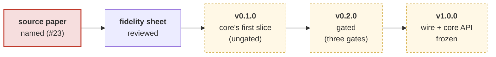

# Roadmap

The plan for Q-Swarm in one page. The live plan is this page plus the
`release:` labels below; issue state is always truer than a checked-in
diagram. The shape is
[ARA's roadmap](https://github.com/swarm-routing/ARA/blob/main/docs/roadmap.md),
itself on the model of
[AntHocNet's](https://github.com/swarm-routing/AntHocNet/blob/main/docs/roadmap.md).
The org-wide train that orders this repository against the others is in the
[org ROADMAP](https://github.com/swarm-routing/.github/blob/main/ROADMAP.md);
the plan that created it is swarm-routing/.github#672, the set-up
swarm-routing/.github#881.

## How this plan is tracked

Each issue a release gates carries that release's **`release:` label**, so
every row of this plan is a live query rather than a diagram that drifts:

| Release | Board |
|---|---|
| v0.1.0 | [`release:v0.1.0`](https://github.com/swarm-routing/Q-Swarm/issues?q=is%3Aopen+label%3A%22release%3Av0.1.0%22) |
| v0.2.0 | [`release:v0.2.0`](https://github.com/swarm-routing/Q-Swarm/issues?q=is%3Aopen+label%3A%22release%3Av0.2.0%22) |
| v1.0.0 | [`release:v1.0.0`](https://github.com/swarm-routing/Q-Swarm/issues?q=is%3Aopen+label%3A%22release%3Av1.0.0%22) |
| all epics | [`epic`](https://github.com/swarm-routing/Q-Swarm/issues?q=is%3Aopen+label%3Aepic) |

Only issues a release actually gates are labelled, one release label per
issue. Unscheduled work lands whenever it lands; the infrastructure track
rides along and never gates. Majors are reserved for breaking changes, and
1.0.0 is the stability promise. Releases are cut on the maintainer's request
only (CONTRIBUTING "Cutting a release").

## Release ladder

Red blocks everything after it; amber is planned. Nothing is released yet.
The source paper (#23) is the maintainer's to name; until then the fidelity
sheet's paper rows stay `unknown` and no protocol code is written (AGENTS.md
golden rule 10).

## What each release must show to ship

| Release | Exit criteria |
|---|---|
| **v0.1.0** "first slice" | (1) #23 is closed: the source paper is named and in `docs/references.bib`; (2) `docs/fidelity.md` is reviewed against it and accepted by the maintainer, every mechanism and parameter of the slice cited or a `repo choice`; (3) `core/`'s first slice (the Q-value table, the energy-aware Bellman update and Boltzmann next-hop selection on swarm-core's ports, and its versioned control header with roundtrip + fuzz tests) builds and tests alone in `core.yml`, with swarm-core's contract tests; (4) `core/` installs as the CMake package `q-swarm-core`, and the release's `vcpkg-ports: q-swarm-core` opens its port PR in swarm-routing/vcpkg-registry; (5) CI green on `main`. Ungated: it has not cleared org rule 6's three gates, and its release notes say so. |
| **v0.2.0** "gated" | (1) the ns-3 adapter (`ns3/`, on swarm-core's `SwarmRoutingBase`) carries the core out with no constant of its own; (2) the per-PR delivery smoke runs; (3) the anchor, pre-registered on its issue from the fidelity sheet's "Anchor candidate" (the WSN convergecast with battery depletion of epic #3, Q-routing [BL93] as comparator), is read with ≥ 20 paired seeds: PASS, or a written infeasibility verdict in `docs/benchmarks/v0.2.0-anchor.md` with its raw cells; (4) every deviation from the paper is a row in `docs/fidelity.md`. |
| **v1.0.0** | Wire format and `core/` API frozen; paper-faithful with the deviations documented; the three gates passed; green on the supported ns-3 release; a released run recorded in the benchmarks global suite. Follows swarm-core's API freeze. |

## Infrastructure track

CI, packaging and tooling items ride along with whichever release is cut
next, carry no `release:` label, and never gate a release: the `core/`
skeleton and its CI, the release workflow, the install guide and the class
documentation of swarm-routing/.github#881.

## Deliberate non-goals

- Any default that moves without a default-off switch and an A/B on identical
  seeds (org golden rule 6).
- Protocol code before the fidelity sheet is reviewed (golden rule 10).

## See also

- The [org ROADMAP](https://github.com/swarm-routing/.github/blob/main/ROADMAP.md): the cross-repository release train.
- [CONTRIBUTING](https://github.com/swarm-routing/.github/blob/main/CONTRIBUTING.md): invariants, issues and labels.
- [`fidelity.md`](fidelity.md): the paper-to-implementation sheet the gates rest on.
